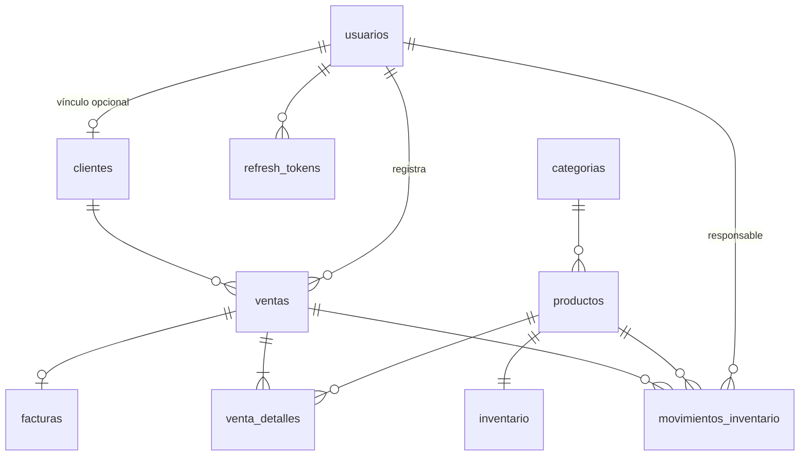

# Handoff para el equipo de base de datos

> **Esto es una propuesta inicial.** El backend necesitaba un esquema para funcionar y para probar las
> reglas de negocio, así que se definió este. Si el equipo de BD cambia el diseño, el flujo es:
> **ajustar los modelos de SQLAlchemy → generar una nueva migración de Alembic → revisarla → aplicarla.**
>
> **La fuente de verdad del esquema son las migraciones** (`backend/alembic/versions/`), no un script SQL
> suelto ni la BD de alguien. No editen tablas a mano en una base compartida.

Motor: **PostgreSQL 16**. Base principal `inventario`; base de pruebas `inventario_test`, que pytest borra y recrea.

## 1. Modelo entidad-relación

El diagrama completo, con columnas, está en [`DIAGRAMA_ER.md`](./DIAGRAMA_ER.md). Resumen de relaciones:



## 2. Diccionario de datos

Convenciones:
- PK `id` entero autoincremental (`SERIAL`). La excepción es `inventario`, cuya PK es `producto_id`.
- Fechas en `timestamptz` (con zona horaria). `created_at` y `updated_at` tienen por defecto `now()`.
- Montos en `NUMERIC(12,2)` y porcentajes en `NUMERIC(5,2)`. **Nunca `float`.**
- Nombres de constraints estables: `pk_<tabla>`, `uq_<tabla>_<col>`, `fk_<tabla>_<col>_<tabla_ref>`,
  `ck_<tabla>_<nombre>`, `ix_<tabla>_<col>`.
- Soft delete con la columna `activo` en usuarios, clientes, categorías y productos.

### `usuarios`
| Columna | Tipo | Nulo | Default | Restricciones |
|---|---|---|---|---|
| id | integer | NO | serial | PK |
| email | varchar(255) | NO | | UNIQUE (`uq_usuarios_email`); se guarda en minúsculas |
| password_hash | varchar(255) | NO | | hash bcrypt |
| nombre | varchar(150) | NO | | |
| rol | `rol_usuario` | NO | `'CLIENTE'` | enum |
| activo | boolean | NO | `true` | |
| created_at / updated_at | timestamptz | NO | `now()` | |

### `refresh_tokens`
Guarda los refresh tokens emitidos para poder rotarlos y revocarlos (logout).
| Columna | Tipo | Nulo | Default | Restricciones |
|---|---|---|---|---|
| id | integer | NO | serial | PK |
| usuario_id | integer | NO | | FK → usuarios.id `ON DELETE CASCADE`; índice |
| jti | varchar(64) | NO | | UNIQUE; id único del token |
| expires_at | timestamptz | NO | | |
| revocado | boolean | NO | `false` | |
| created_at | timestamptz | NO | `now()` | |

### `clientes`
| Columna | Tipo | Nulo | Default | Restricciones |
|---|---|---|---|---|
| id | integer | NO | serial | PK |
| usuario_id | integer | SÍ | | FK → usuarios.id `ON DELETE SET NULL`; UNIQUE (1:1 opcional) |
| tipo_documento | `tipo_documento` | NO | `'CC'` | enum |
| documento | varchar(30) | NO | | UNIQUE (`tipo_documento`, `documento`) |
| nombre | varchar(150) | NO | | índice |
| email | varchar(255) | SÍ | | índice |
| telefono | varchar(30) | SÍ | | |
| direccion | varchar(255) | SÍ | | |
| activo | boolean | NO | `true` | |
| created_at / updated_at | timestamptz | NO | `now()` | |

### `categorias`
| Columna | Tipo | Nulo | Default | Restricciones |
|---|---|---|---|---|
| id | integer | NO | serial | PK |
| nombre | varchar(100) | NO | | UNIQUE. El backend también evita duplicados sin importar mayúsculas |
| descripcion | varchar(255) | SÍ | | |
| activo | boolean | NO | `true` | |
| created_at / updated_at | timestamptz | NO | `now()` | |

### `productos`
| Columna | Tipo | Nulo | Default | Restricciones |
|---|---|---|---|---|
| id | integer | NO | serial | PK |
| sku | varchar(50) | NO | | UNIQUE; el backend lo guarda en MAYÚSCULAS |
| nombre | varchar(150) | NO | | índice |
| descripcion | text | SÍ | | |
| categoria_id | integer | SÍ | | FK → categorias.id `ON DELETE RESTRICT`; índice |
| precio_venta | numeric(12,2) | NO | | CHECK `precio_venta >= 0`; **sin IVA** |
| costo | numeric(12,2) | NO | | CHECK `costo >= 0` |
| activo | boolean | NO | `true` | índice; soft delete |
| created_at / updated_at | timestamptz | NO | `now()` | |

### `inventario`
Una fila por producto (1:1). Se crea en la misma transacción que el producto.
| Columna | Tipo | Nulo | Default | Restricciones |
|---|---|---|---|---|
| producto_id | integer | NO | | PK y FK → productos.id `ON DELETE CASCADE` |
| stock | integer | NO | `0` | CHECK `stock >= 0` (última barrera contra la sobreventa) |
| stock_minimo | integer | NO | `0` | CHECK `stock_minimo >= 0` |
| updated_at | timestamptz | NO | `now()` | |

### `movimientos_inventario`
Historial que no se modifica. Todo cambio de `inventario.stock` deja aquí una fila, en la misma transacción.
| Columna | Tipo | Nulo | Default | Restricciones |
|---|---|---|---|---|
| id | integer | NO | serial | PK |
| producto_id | integer | NO | | FK → productos.id `RESTRICT`; índice |
| tipo | `tipo_movimiento` | NO | | enum |
| cantidad | integer | NO | | CHECK `cantidad > 0`. En AJUSTE es `abs(stock_nuevo - stock_anterior)` |
| stock_anterior | integer | NO | | |
| stock_nuevo | integer | NO | | CHECK `stock_nuevo >= 0` |
| motivo | varchar(255) | NO | | ej. `Venta #5`, `Anulación venta #5`, `Stock inicial` |
| usuario_id | integer | NO | | FK → usuarios.id `RESTRICT`; índice |
| venta_id | integer | SÍ | | FK → ventas.id `RESTRICT`; índice. Solo para movimientos de ventas |
| fecha | timestamptz | NO | `now()` | índice |

### `ventas`
| Columna | Tipo | Nulo | Default | Restricciones |
|---|---|---|---|---|
| id | integer | NO | serial | PK |
| cliente_id | integer | NO | | FK → clientes.id `RESTRICT`; índice |
| usuario_id | integer | NO | | FK → usuarios.id `RESTRICT`; índice. Quién la registró (el cliente o un admin) |
| estado | `estado_venta` | NO | `'PENDIENTE'` | enum; índice |
| total | numeric(12,2) | NO | `0` | CHECK `total >= 0`. Suma de subtotales, **antes de IVA** |
| observaciones | varchar(255) | SÍ | | |
| pagada_at | timestamptz | SÍ | | |
| anulada_at | timestamptz | SÍ | | |
| motivo_anulacion | varchar(255) | SÍ | | |
| created_at / updated_at | timestamptz | NO | `now()` | `created_at` = fecha de la venta |

### `venta_detalles`
| Columna | Tipo | Nulo | Default | Restricciones |
|---|---|---|---|---|
| id | integer | NO | serial | PK |
| venta_id | integer | NO | | FK → ventas.id `ON DELETE CASCADE`; índice |
| producto_id | integer | NO | | FK → productos.id `RESTRICT`; índice |
| cantidad | integer | NO | | CHECK `cantidad > 0` |
| precio_unitario | numeric(12,2) | NO | | CHECK `>= 0`; precio copiado del producto al crear la venta |
| subtotal | numeric(12,2) | NO | | CHECK `>= 0`; `cantidad × precio_unitario` |
| | | | | UNIQUE (`venta_id`, `producto_id`) |

### `facturas`
| Columna | Tipo | Nulo | Default | Restricciones |
|---|---|---|---|---|
| id | integer | NO | serial | PK |
| consecutivo | integer | NO | | UNIQUE; tomado de la secuencia `factura_consecutivo_seq` |
| numero | varchar(20) | NO | | UNIQUE; formato `FAC-000001` |
| venta_id | integer | NO | | FK → ventas.id `RESTRICT`; UNIQUE (una factura por venta) |
| subtotal | numeric(12,2) | NO | | CHECK `>= 0` |
| porcentaje_iva | numeric(5,2) | NO | | CHECK entre 0 y 100. Valor de `IVA_PORCENTAJE` al emitir |
| impuestos | numeric(12,2) | NO | | CHECK `>= 0`; redondeo HALF_UP a 2 decimales |
| total | numeric(12,2) | NO | | CHECK `total = subtotal + impuestos` |
| fecha_emision | timestamptz | NO | `now()` | índice |
| anulada | boolean | NO | `false` | |
| anulada_at | timestamptz | SÍ | | |

### Enums (tipos nativos de PostgreSQL)
| Tipo | Valores |
|---|---|
| `rol_usuario` | `ADMIN`, `CLIENTE` |
| `tipo_documento` | `CC`, `CE`, `NIT`, `PAS` |
| `tipo_movimiento` | `ENTRADA`, `SALIDA`, `AJUSTE` |
| `estado_venta` | `PENDIENTE`, `PAGADA`, `ANULADA` |

### Secuencias especiales
- `factura_consecutivo_seq`: numeración de facturas (se crea en la migración `0004`).

## 3. Reglas de negocio que dependen del esquema

- **Descuento de stock:** al confirmar una venta, el backend bloquea las filas de `inventario` con
  `SELECT … FOR UPDATE` (en orden de `producto_id`, para evitar deadlocks). En la misma transacción
  descuenta el stock, inserta los movimientos SALIDA y cambia el estado a PAGADA. Si algo falla, no se guarda nada.
- **Anulación:** hace lo inverso con movimientos ENTRADA y marca la factura como `anulada = true`. Las ventas
  pagadas o facturadas nunca se borran; solo se puede borrar una venta PENDIENTE.
- **Soft delete:** productos, clientes, categorías y usuarios no se borran. Por eso las FK usan `RESTRICT`.

## 4. Migraciones: cómo trabajar

```powershell
cd "C:\Users\Santiago\Documents\Ucaldas\5to Semestre\Programacion web ll\Inventario\backend"
.venv\Scripts\Activate.ps1

alembic current                 # versión aplicada en tu BD
alembic history                 # lista de migraciones
alembic upgrade head            # aplica todo
alembic downgrade -1            # revierte la última

# Después de cambiar un modelo en app/models/:
alembic revision --autogenerate -m "describe el cambio"
#   → REVISA el archivo generado en alembic/versions/. Autogenerate NO detecta:
#     renombres (los ve como drop + add, y eso pierde datos), cambios en valores de ENUM,
#     secuencias ni CHECK nuevos en todos los casos.
alembic upgrade head
alembic check                   # debe decir "No new upgrade operations detected"
pytest                          # las pruebas aplican las migraciones desde cero
```

Migraciones actuales:
| Revisión | Contenido |
|---|---|
| `0001` | usuarios, refresh_tokens, clientes |
| `0002` | categorias, productos |
| `0003` | inventario (con relleno para los productos existentes), movimientos_inventario |
| `0004` | ventas, venta_detalles, facturas, `factura_consecutivo_seq`, FK movimientos → ventas |

Si prefieren diseñar en SQL, también sirve: después se pasa a modelos y migraciones. Para ver el SQL que
generan las migraciones actuales: `alembic upgrade head --sql > esquema.sql`.

## 5. Puntos abiertos para decidir juntos

1. **Multi-bodega.** Hoy hay un solo stock por producto. Para varias bodegas: tabla `bodegas` e `inventario`
   con PK (`producto_id`, `bodega_id`); los movimientos y las ventas llevarían `bodega_id`, y harían falta
   traslados entre bodegas.
2. **Impuestos por producto.** Hoy el IVA es global (`IVA_PORCENTAJE`) y se aplica en la factura. En Colombia
   hay productos exentos o con el 5 %. Opción: `productos.porcentaje_iva` y guardar el IVA por línea en
   `venta_detalles`.
3. **Numeración de facturas.** La secuencia de PostgreSQL puede dejar huecos si una transacción falla. Si se
   necesita numeración sin huecos (exigencia de la DIAN), habría que usar una tabla `numeracion_facturas`
   bloqueada con `FOR UPDATE`, además de prefijo y rango autorizado (resolución de facturación).
4. **¿El precio de venta incluye IVA?** Se asumió que no. Hay que confirmarlo con el equipo.
5. **Categorías:** ¿tabla propia (como está) o jerarquía de subcategorías (`parent_id`)?
6. **Unidades de medida y decimales en el stock** (kg, litros): hoy `stock` es entero.
7. **Proveedores y compras:** hoy una compra es una ENTRADA manual con su motivo. ¿Hacen falta tablas
   `proveedores` y `compras`?
8. **Auditoría:** ¿se necesita un historial de cambios de precio o de quién editó cada registro?
9. **Datos personales:** los clientes tienen documento, email y teléfono. Revisar si aplica la Ley 1581 de 2012
   (habeas data) y si se cifra algún campo.
10. **Tipos de ID:** `SERIAL` (int4) frente a `IDENTITY` o UUID. El tipo actual alcanza para el proyecto.
